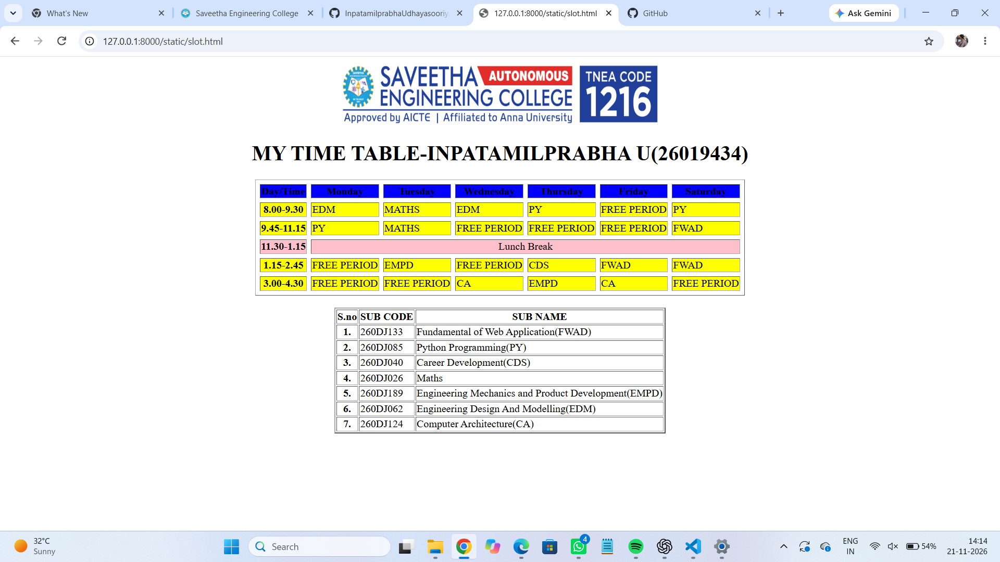

# Ex04 Time Table
## Date:21.11.2026

## AIM
To write a html webpage page to display your slot timetable.

## ALGORITHM
### STEP 1
Create a Django-admin Interface.

### STEP 2
Create an App inside the Django project.

### STEP 2
Create a static folder uder the created App and insert HTML code.

### STEP 3
Create a simple table using ```<table>``` tag in html with the relevant attributes.

### STEP 4
Add rows using ```<tr>``` tag.

### STEP 5
Add your course schedule using ```<td>``` tag.

### STEP 6
Execute the program using runserver command.

## PROGRAM
```
slot.html

<html>
    <head>
       
        
       
    </head>
    <body align="center">
       
      <h1> MY TIME TABLE-INPATAMILPRABHA U(26019434)</h1>   
        
        
        <table  align="center" border="1" cellspacing="7" cellpading="8">
        <tr bgcolor="blue">
            <th>Day/Time</th>
            <th>Monday</th>
            <th>Tuesday</th>
            <th>Wednesday</th>
            <th>Thursday</th>
            <th>Friday</th>
            <th>Saturday</th>
        </tr>
        <tr bgcolor="yellow">
            <th>8.00-9.30</th>
            <td>EDM</td>
            <td>MATHS</td>
            <td>EDM</td>
            <td>PY</td>
            <td>FREE PERIOD</td>
            <td>PY</td>
        </tr>
        <tr bgcolor="yellow">
            <th>9.45-11.15</th>
            <td>PY</td>
            <td>MATHS</td>
            <td>FREE PERIOD</td>
            <td>FREE PERIOD</td>
            <td>FREE PERIOD</td>
            <td>FWAD</td>
        </tr>
        <tr bgcolor="pink" align="center">
            <th>11.30-1.15</th>
            <td colspan="7">Lunch Break</td>
        </tr>  
        <tr bgcolor="yellow">
            <th>1.15-2.45</th>
            <td>FREE PERIOD</td>
            <td>EMPD</td>
            <td>FREE PERIOD</td>
            <td>CDS</td>
            <td>FWAD</td>
            <td>FWAD</td>
         </tr> 
         <tr bgcolor="yellow">
            <th>3.00-4.30</th>
            <td>FREE PERIOD</td>
            <td>FREE PERIOD</td>
            <td>CA</td>
            <td>EMPD</td>
            <td>CA</td>
            <td>FREE PERIOD</td>
         </tr>
         </table>
          <br>
        <table align="center" border="2">
            <tr >
                <th>S.no</th>
                <th>SUB CODE</th>
                <th>SUB NAME</th>
            </tr>
            <tr>
                <th>1.</th>
                <td>260DJ133</td>
                <td>Fundamental of Web Application(FWAD)</td>
            </tr>
            <tr>
                <th>2.</th>
                <td>260DJ085</td>
                <td>Python Programming(PY)</td>
            </tr>
            <tr>
                <th>3.</th>
                <td>260DJ040</td>
                <td>Career Development(CDS)</td>
            </tr>
            <tr>
                <th>4.</th>
                <td>260DJ026</td>
                <td>Maths</td>
            </tr>
            <tr>
                <th>5.</th>
                <td>260DJ189</td>
                <td>Engineering Mechanics and Product Development(EMPD)</td>
            </tr>
            <tr>
                <th>6.</th>
                <td>260DJ062</td>
                <td>Engineering Design And Modelling(EDM)</td>
            </tr>
            <tr>
                <th>7.</th>
                <td>260DJ124</td>
                <td>Computer Architecture(CA)</td>
            </tr>
        </table> 
         
    </body>
</html>


```


## OUTPUT



## RESULT
The program for creating slot timetable using basic HTML tags is executed successfully.
